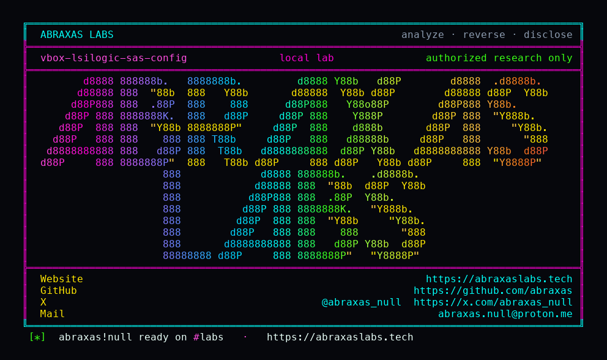

<p align="center">
  
</p>

<p align="center">
  <a href="https://abraxaslabs.tech"><strong>abraxaslabs.tech</strong></a>
  &nbsp;·&nbsp;
  <a href="https://github.com/abraxas">github.com/abraxas</a>
  &nbsp;·&nbsp;
  <a href="https://x.com/abraxas_null">@abraxas_null</a>
  &nbsp;·&nbsp;
  <a href="mailto:abraxas.null@proton.me">abraxas.null@proton.me</a>
  &nbsp;·&nbsp;
  <a href="https://github.com/abraxas/vbox-lsilogic-sas-config">vbox-lsilogic-sas-config</a>
</p>

# vbox-lsilogic-sas-config

**Class:** Type confusion / arb R/W
**Reach:** Local (guest)

**Oracle VM VirtualBox OSS** `7.2.20` (`f2792cf44f663989818507e36d3db5f978523c5e`)

SAS1068 MPT CONFIG treats SCSI-SPI Port 0 as a 12-byte page. On SAS that page is the other half of a union: `pManufacturingPage7` plus `cbManufacturingPage7`. A guest CONFIG READ DMA-leaks the heap pointer. A CONFIG WRITE plants pointer and size. Manufacturing page 7 then copies through the planted pointer.

**Guest ring3 on an attached SAS1068 (PDM `LsiLogicSas`, PCI `1000:0054`) gets arbitrary read/write in the VM process.** That is VirtualBoxVM / VBoxHeadless heap, not a host-kernel escape.

| | |
|---|---|
| ID | no CVE yet |
| Class | **Type confusion / arb R/W** |
| Reach | **Local (guest)** |
| CWE | [CWE-843](https://cwe.mitre.org/data/definitions/843.html), [CWE-822](https://cwe.mitre.org/data/definitions/822.html) |
| CVSS | **Critical: 8.8** `CVSS:3.1/AV:L/AC:L/PR:L/UI:N/S:C/C:H/I:H/A:H` |
| Product | [VirtualBox OSS](https://github.com/VirtualBox/virtualbox) |
| Affected | **7.2.20** (`f2792cf44`) |
| Needs | attached SAS1068 (PDM `LsiLogicSas`, PCI `1000:0054`) |
| License | [GNU Affero GPL v3.0](LICENSE) |
| Lab | loopback source harness |

## What an attacker can do

Method: guest ring3 programs the SAS1068 MMIO doorbell or request FIFO with `MPT_MESSAGE_HDR_FUNCTION_CONFIG` (0x04), page type SCSI-SPI Port 0 (0x03). Dispatch always calls the SPI getter. Only EXTENDED is SAS-gated. The page-attribute getter is commented out, so the Readonly Port 0 page is still writable. SPI Port 0 is packed 12 bytes and overlays `SasPages.pManufacturingPage7` (8) plus `cbManufacturingPage7` (4).

| Privilege | Kind | Status | What it grants |
|---|---|---|---|
| CONFIG SCSI-SPI Port 0 READ | recon | **lab-proven** | DMA of the VM-process heap pointer `pManufacturingPage7` and its size into guest RAM. ASLR input. |
| CONFIG SCSI-SPI Port 0 WRITE | integrity | **lab-proven** | plant guest-chosen pointer + size over those SAS fields |
| manufacturing page 7 CONFIG READ | integrity | **lab-proven** | copy host bytes from the planted address into guest GPA (`VBOX-LSILOGIC-SAS-CONFIG-WITNESS`) |
| manufacturing page 7 CONFIG WRITE | integrity | inferred from the same getter | copy guest bytes to the planted address (arb write in VirtualBoxVM) |
| Port 1 / Device 0 SPI pages | recon / integrity | inferred overlay | Port 1 leaks/plants `pSASIOUnitPage0`; Device 0 page 0 hits `paPHYs`; Device 0 page 1 hits `pSASDeviceHead` |
| wild planted pointer | availability | inferred | crash the VM process on the next SAS page access or on `lsilogicR3ConfigurationPagesFree` |

Closed adjacent:

- host kernel
- other VMs
- VBoxSVC
- default Windows-guest LSI53C1030 SPI (`SpiPages` is the real layout; this type-confusion needs SAS1068)
- SAS EXTENDED pages on a SPI controller (`VERR_NOT_FOUND`)
- Windows hardening token / AppContainer (this is VM-process heap, not a sandbox bypass)

This is VM-process arb R/W, not host-kernel escape. Full host-user still needs a hardening leftover. I did not pair it with a remaining 3D write: VMSVGA DX11 UAF (`d691aa68`) is closed on this pin.

No Guest Additions. No 3D. No VRDP. Not PUEL. Hostile guest ring3 is enough; the in-box mpt/mptsas driver is not required.

## How I found it

I sat on OSS 7.2.20 after the Sep 2026 CPU and walked LsiLogic MPT CONFIG. The silent 2026 reply-stack leak is already closed: `122c6880` `RT_ZERO`s `MptReplyUnion` on SCSI I/O error. I was looking for a leftover of that class, not that sink.

The leftover is a union, not a stack reply:

```c
union {
    MptConfigurationPagesSpi SpiPages;
    MptConfigurationPagesSas SasPages;
} u;  /* DevLsiLogicSCSI.h:3323 */
```

SAS alloc fills `SasPages` host pointers and never runs SPI page init. The SPI Port getter at `DevLsiLogicSCSI.cpp:2795` has no `enmCtrlType` check. CONFIG dispatch SPI cases are ungated. The page-attribute getter is commented out at `cpp:3159`. Manufacturing page 7 at `cpp:2701` is SAS-gated, which is the intended path, and dereferences `pManufacturingPage7` with no NULL check. That is how a SPI-typed Port 0 READ/WRITE becomes a SAS pointer leak and plant.

Wrong turns already recorded: re-filing `122c6880`; treating default LSI53C1030 as this bug; inflating a wild-pointer crash to host-kernel escape; a live VM when the packed overlay is enough. Theatre: a reverse shell. The oracle is CONTROL dummy page data, then leak/plant/arb-read of `VBOX-LSILOGIC-SAS-CONFIG-WITNESS`.

## Lab

```bash
cd lab
./run.sh
```

Or `python3 vbox-lsilogic-sas-config-Abraxas-Labs.py`. Source harness of the pin structs. VirtualBox is not booted. Compose project `vbox-lsilogic-sas-config`, `network_mode: none`. Bind nothing.

CONTROL: SPI-typed Port 0 overlay-read is dummy page data, not the manufacturing-page-7 heap pointer.

SAS confused: Port 0 READ leaks `pManufacturingPage7` matching calloc. Port 0 WRITE plants a second witness buffer pointer+size. Manufacturing page 7 getter plus CONFIG READ copies the witness into the guest GPA array.

```text
SUCCESS vbox-lsilogic-sas-config leak=yes plant=yes arb-read=yes VBOX-LSILOGIC-SAS-CONFIG-WITNESS
```

## The fix

Gate SCSI-SPI page types on `enmCtrlType == LSILOGICCTRLTYPE_SCSI_SPI`. Restore the page-attribute check so Readonly Port 0 stays read-only. NULL-check `pManufacturingPage7` (and the other SAS pointers) before dereference. Stop overlaying `SpiPages` and `SasPages` in one union.

## References

- [github.com/VirtualBox/virtualbox](https://github.com/VirtualBox/virtualbox) tag [v7.2.20](https://github.com/VirtualBox/virtualbox/releases/tag/v7.2.20) (`f2792cf44f663989818507e36d3db5f978523c5e`)
- [`DevLsiLogicSCSI.h`](https://github.com/VirtualBox/virtualbox/blob/f2792cf44f663989818507e36d3db5f978523c5e/src/VBox/Devices/Storage/DevLsiLogicSCSI.h) union at 3323; SPI Port 0 size 12 at 2251
- [`DevLsiLogicSCSI.cpp`](https://github.com/VirtualBox/virtualbox/blob/f2792cf44f663989818507e36d3db5f978523c5e/src/VBox/Devices/Storage/DevLsiLogicSCSI.cpp) SAS alloc 619; manufacturing getter 2701; SPI Port getter 2795; page-attribute commented out 3159; CONFIG READ/WRITE 3293
- Closed sibling, not this sink: [`122c6880`](https://github.com/VirtualBox/virtualbox/commit/122c6880) (`MptReplyUnion` SCSI I/O error stack)
